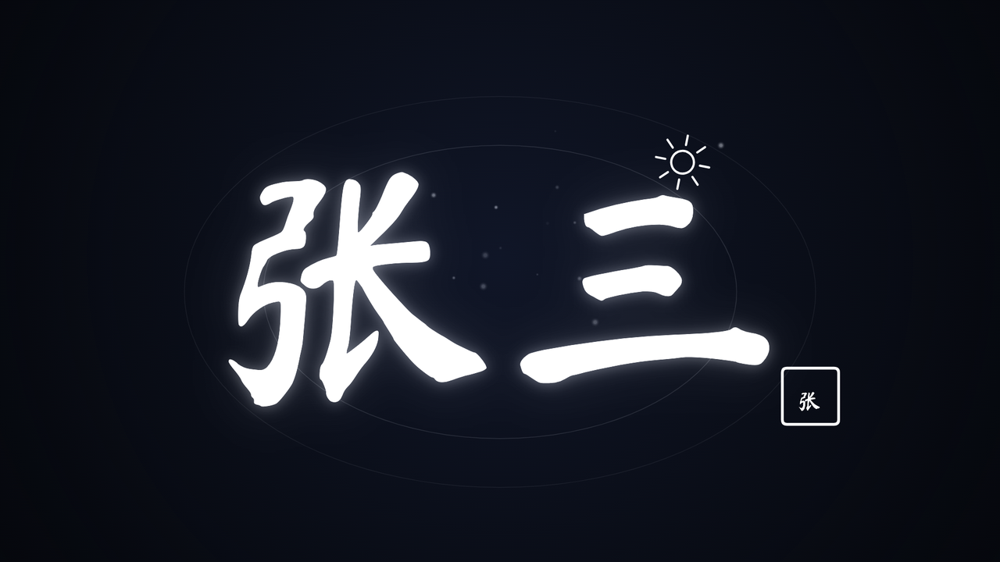
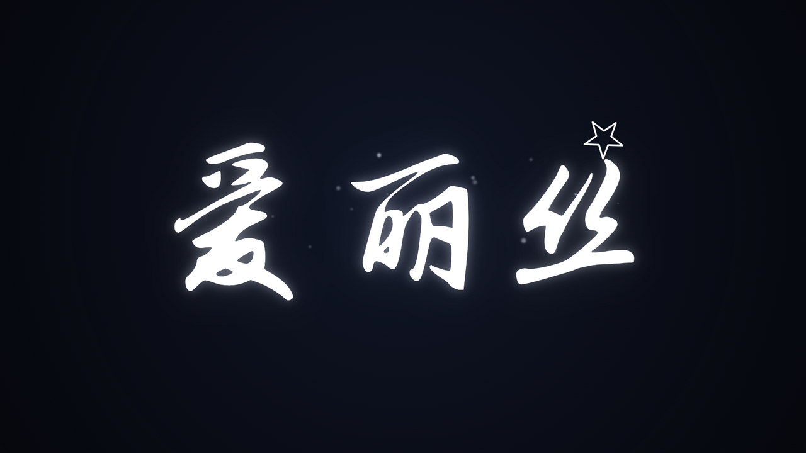
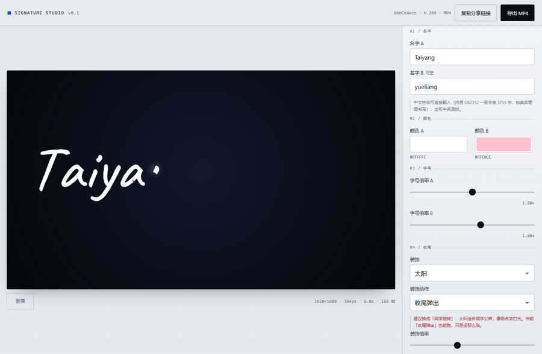
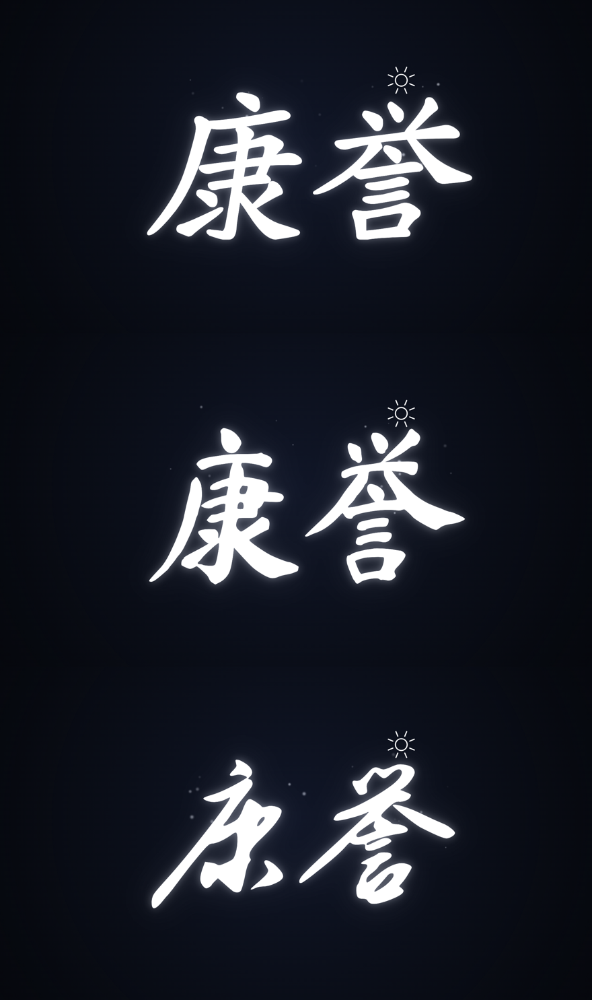
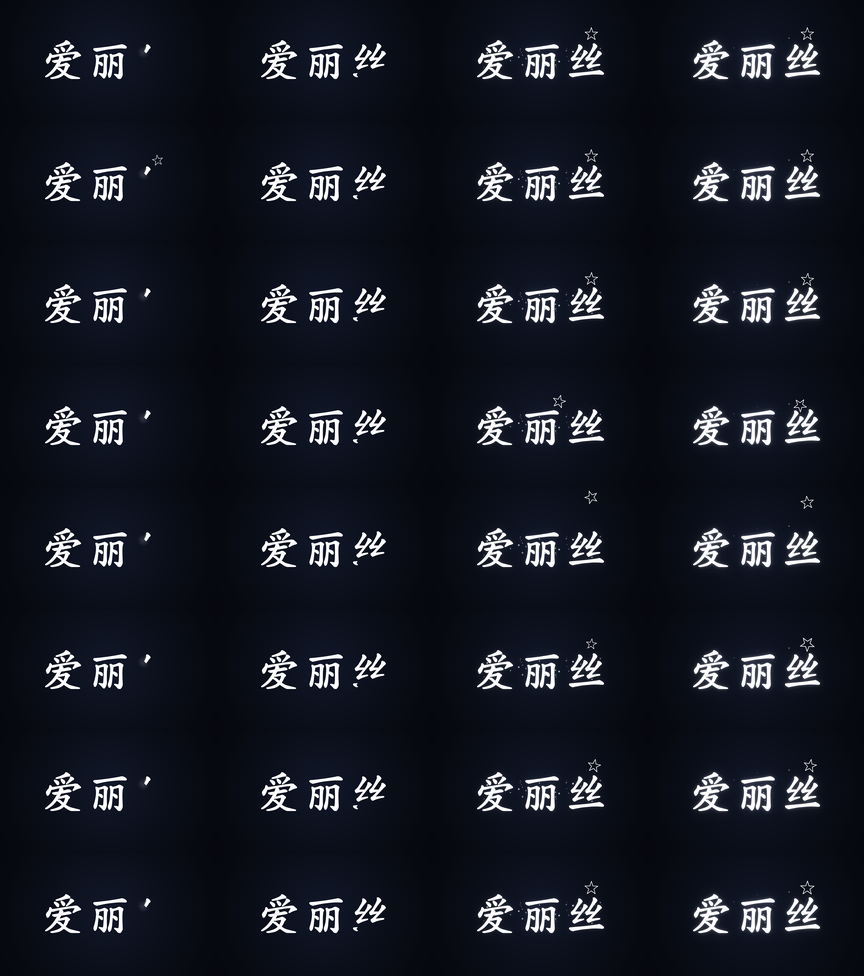

# SIGNATURE STUDIO · 动态手写签名生成器

输入名字（拉丁字母或中文姓名，如 张三 / 李四 / 康誉），笔尖就按**真实笔顺**一笔一笔把名字写出来，写完收尾弹出装饰，然后一键导出**真 MP4**。纯前端，无后端，不用 React / Vue / Tailwind / WebGL。



<p align="center">
  
  
</p>

---

## 它是什么

一个单文件的"签名动画生成器"：左边是深色舞台里的实时预览，右边是 14 个参数（名字、颜色、字号、装饰、装饰动作、中文字体、笔迹风格、动态效果、时长、画幅）。所有参数都写进 URL hash，链接即配置；导出走 WebCodecs 离线帧循环，帧数严格等于 `时长 × 30`，同一组参数重导出的画面逐帧一致。

产物 `dist-single/签名生成器.html` 约 16.7MB（汉字笔画数据 9.1MB + 两档手写字体 6.8MB base64），拷到任何地方双击就能用，不联网也跑。

## 特性

| | |
| --- | --- |
| **按笔顺书写** | 汉字用 Make Me a Hanzi 的真实笔顺数据（6763 字），拉丁字母用骨架化 + 就近接笔推导；遮罩沿骨架推进，笔与笔之间留抬笔空窗 |
| **中文字体三档** | 内置楷书（矢量轮廓）/ 毛笔楷书·马善政 / 行书·志莽 —— 换字体只换"肉"，笔顺不变；字体缺字时整名退回楷书并说明 |
| **四档笔迹风格** | 细笔 / 毛笔出锋 / 连笔签名（带飞白弧、字距收紧）/ 圆润粗笔，做法是几何加工，不换字体、切换即时 |
| **15 种装饰 × 8 档动作** | 太阳/月亮/星星/爱心/猫耳/小狗/云朵… 各自可绕字公转、落下弹跳、自旋入场、钟摆摇晃、呼吸缩放；面板会告诉你哪种装饰配哪个动作 |
| **5 个动态效果** | 笔尖拖尾、墨点飞溅、呼吸辉光、写完涟漪、落款印章，全部只依赖 `t`，可多选叠加 |
| **真 MP4 导出** | WebCodecs `avc1` + `mp4-muxer`，每秒一个关键帧、编码背压、可取消；Safari 自动降级 WebM 草稿 |
| **性能** | 拖动滑块低质量档 ≤16ms 出图，松手 120ms 后全质量重建；辉光按参数指纹缓存，不每帧重算 `shadowBlur` |
| **可访问** | 热区 ≥44px、键盘可达、`prefers-reduced-motion` 直接渲染末帧、375px 起不破版 |

## 快速开始

```bash
npm install
npm run dev          # http://localhost:5173，改代码自动重建
npm run build        # 多文件产物 -> dist/
npm run build:single # 单文件产物 -> dist-single/签名生成器.html（字体已 base64 内联，可直接双击打开）
npm run typecheck    # npx tsc --noEmit
```

`dist-single/签名生成器.html` 是自包含的一个文件：拷到任何地方双击就能用，不联网也跑。

**环境要求**：Node ≥ 18（本机实测 v22.23.2）。导出 MP4 需要支持 WebCodecs 的浏览器（Chrome / Edge 116+）。Safari 走 WebM 回退。

## 目录

- [为什么是 esbuild 而不是 Vite](#为什么是-esbuild-而不是-vite)
- [关于字形数据（两种字各有各的路）](#关于字形数据两种字各有各的路)
- [中文姓名是怎么写出来的](#中文姓名是怎么写出来的)
- [中文字体（两种手写真字体 + 内置楷书）](#中文字体两种手写真字体--内置楷书)
- [字形是怎么变成"能按笔顺写"的](#字形是怎么变成能按笔顺写的)
- [参数（14 个）](#参数14-个)
- [笔迹风格与动态效果（怎么实现"更像手写"）](#笔迹风格与动态效果怎么实现更像手写)
- [项目结构](#项目结构)
- [第三方资源与许可](#第三方资源与许可)
- [已知限制](#已知限制)
- [验收清单（逐条实测）](#验收清单逐条实测)

---

### 为什么是 esbuild 而不是 Vite

原始方案写的是 Vite，但本机（Windows，带 AppLocker 类策略）加载 rollup 原生模块时会被拦：

```
Error: An Application Control policy has blocked this file
node_modules\@rollup\rollup-win32-x64-msvc\rollup.win32-x64-msvc.node  →  ERR_DLOPEN_FAILED
```

实测 esbuild 的可执行二进制能正常跑，于是整体换成 esbuild：`scripts/build.mjs`（构建）与 `scripts/dev.mjs`（监听 + 起服务）。`vite` 与 `vite-plugin-singlefile` 已从依赖里移除，**不要再用 `vite build`**。这也顺带解决了"换台机器 `npm run build` 就挂"的问题。

### 关于字形数据（两种字各有各的路）

**拉丁 / 数字 / 标点**：原方案要求 `scripts/generate-glyphs.ts` 离线生成 `src/data/glyphs.json`。这条路要 node-canvas 这种原生模块，在这台机器上跑不起来。改用**运行时按需生成 + 内存缓存**：

- `getGlyph(ch)` 首次调用时把字符栅格化到 200px（`NOMINAL_PX`），跑完"二值化 → Zhang–Suen 细化 → 距离变换 → 追踪 → RDP 简化 → 合段 → 排序"整条管线，之后按 `${cacheEpoch}:${ch}` 命中缓存；
- 排版时按 `size / NOMINAL_PX` 缩放坐标与笔宽；
- `clearGlyphCache()` 在字体加载完成后失效缓存（`cacheEpoch++`），所以字体到位后重算一遍；
- 代价：每个新字符首次生成要几十毫秒（在 `requestIdleCallback` 里做，不挡交互）。

**中文**：不进这条管线，走现成笔画数据（见下一节），`src/data/glyphs.json` 因此**不存在**。想换手写体，把 `src/assets/caveat-400.woff2` / `caveat-700.woff2` 换掉（保持文件名，或同时改 `src/style.css` 里的 `@font-face`），刷新页面即是新字形 —— 只影响拉丁字符，中文用的是矢量轮廓，与字体无关。

### 中文姓名是怎么写出来的

1. 笔画数据来自 [hanzi-writer-data](https://github.com/chanind/hanzi-writer-data)（2.0.1，源自 Make Me a Hanzi / Arphic 楷书，遵循 Arphic Public License，许可原文见 `src/data/ARPHICPL.txt`）。
2. `scripts/build-hanzi.mjs` 用 `TextDecoder('gbk')` 遍历 GB2312 `0xB0A1–0xF7FE`，解出**全部 6763 个汉字**（一级 3755 常用 + 二级 3008 次常用，如「婷」「毓」都在二级），逐字取 `strokes`（每笔的 SVG 轮廓路径）与 `medians`（每笔的中线点列）。
3. 坐标量化成 0–1023 整数，每个坐标 2 位 base36（36²=1296 > 1024，**无损**），笔画间用 `#`、轮廓与中线间用 `$` 分隔，`HANZI_CHARS` / `HANZI_DATA` 两张平行表写进 `src/data/hanzi.ts`（9.1MB 源码，6763 字）。
4. 运行时 `src/signature/hanzi.ts` 首次用到某字才拆表、解码、缓存；`buildHanziGlyph` 把**笔画轮廓**填成墨迹（矢量，跟系统字体无关，任何机器一致），把 `medians` 当作骨架与笔顺（数组顺序就是真实笔顺，不需要细化/合段/猜顺序）。注意这套数据的 **y 轴是向上的**（基线 y≈0，字身往正方向长），而屏幕 y 向下，所以装配位图和渲染矢量时各翻一次 y，别直接把 y 当屏幕坐标用 —— 这是第一版"中文整个上下颠倒"的根因。
5. 仍然复用同一套登场时间图与遮罩：沿中线铺种子做两轮 BFS，得到"每个墨迹像素属于第几笔、走到这一笔的百分之几"，逐帧揭开。
6. 楷书笔画偏瘦，`drawGlyphInk` 在填完轮廓后按 1.2% em 同色描一圈边给墨迹"长肉"，笔形不变。
7. **换中文字体**（程序员最关心的一条）：`buildHanziGlyph(ch, fontKey)` 有两种肉 —— `kai` 继续填 Arphic 矢量轮廓；`brush` / `cursive` 用内嵌手写体 `fillText` 位图当墨迹。**骨永远来自 `medians`**，所以换字体不改笔顺：把中线按字体墨迹的包围盒做等比缩放 + 中心对齐（`min(sx,sy)`，防止骨架跑到字形外的笔画永远揭示不出来），宽度仍由距离变换回填，再跑同一套两轮 BFS。字体里没这个字（`inkCount < 30`）自动退回 `kai`，不留白。

### 中文字体（两种手写真字体 + 内置楷书）

| 选项 | 字体族 | 来源 | 授权 | 体积（3755 字子集） |
| --- | --- | --- | --- | --- |
| `kai` 楷书 · 内置笔画 | 无（矢量轮廓 + 笔顺数据） | hanzi-writer-data / Arphic | Arphic Public License | 0（数据已含，6763 字全覆盖） |
| `brush` 毛笔楷书 · 马善政 | `MSZ Brush` = Ma Shan Zheng | [@fontsource/ma-shan-zheng](https://fontsource.org/fonts/ma-shan-zheng) 5.3.1 | OFL-1.1 | 2.95MB（一级 3755 字） |
| `cursive` 行书 · 志莽 | `ZMX Cursive` = Zhi Mang Xing | [@fontsource/zhi-mang-xing](https://fontsource.org/fonts/zhi-mang-xing) 5.3.0 | OFL-1.1 | 2.06MB（一级 3755 字） |

**字表覆盖与字体覆盖不是一回事**：笔画数据（也就是"能不能写这个字"）覆盖 GB2312 全部 6763 字；两款手写字体为了控体积只裁了一级字表 3755 字。「婷」这类二级字在毛笔/行书里没有字形时，`cjkCover()`（`src/signature/cjkCover.ts`，由 `scripts/cover-cjk.py` 从字体 cmap 导出）会先拦下来 —— **整个名字统一退回内置楷书**，面板同时说明「所选手写字体只裁了常用字，「婷」在里面没有字形……」。
为什么不能只查"画出来有没有墨"：字体缺字时浏览器会**静默**换系统字体顶上，画出来是一行印刷体和手写混在一起，比直接退回楷书更难看。所以必须有明确的 cmap 清单。



**为什么不整份塞字体**：两款字体的全量 TTF 各 5–10MB，直接内联会把单文件推到 30MB。`scripts/build-cjk.py` 走的是"按本站支持的字裁剪"：读 `src/data/hanzi.ts` 的 `HANZI_CHARS`（3755 字）→ 拉 fontsource 的 `index.css` 解析每个分片的 `unicode-range` → 只下命中分片 → fontTools 合并 → 按字符集 subset → 输出**一个** woff2 到 `src/assets/cjk/{id}.woff2`，并生成同名 `.css`（一行 `@font-face`），由 `src/style.css` 里 `@import` 进来、esbuild 的 `.woff2 → dataurl` 内联进产物。

```bash
python scripts/build-cjk.py          # 重新生成 / 更新字体子集（需要 fontTools + brotli）
python scripts/build-cjk.py brush    # 只重建其中一款
npm run build:single
```

体积与收益的取舍：马善政（毛笔）2.95MB、志莽（行书）2.06MB，两款加起来把单文件从 5.0MB 推到 11.7MB。第三款（龙藏 LongCang）实测再 +2.5MB、观感与行书接近，为了不让文件继续膨胀**没有收进来**；想加回来把 `scripts/build-cjk.py` 的 `FONTS` 里那行取消注释、重新跑，再补 `src/signature/cjkfont.ts`、`src/config.ts` 的 `CJKFontKey`、`index.html` 的 `<option>` 与 `src/style.css` 的 `@import` 四处即可。

字体晚到会被"系统字体顶替"画成印刷体，所以 `main.ts` 在 boot 和每次切字体时都先 `await ensureCjkFont(key)`（`document.fonts.load('96px "<family>"', '康誉…')`）再 `clearGlyphCache()` 重建；`Art.key` 与 glyph 缓存键都带上了字体，切字体不会命中旧缓存。

**重新生成数据**（覆盖范围、编码格式要改都从这里改）：

```bash
npm pack hanzi-writer-data@2.0.1                # 得到 hanzi-writer-data-2.0.1.tgz
mkdir -p .vendor/hanzi && tar -xzf hanzi-writer-data-2.0.1.tgz -C .vendor/hanzi
npm run gen:hanzi                               # = node scripts/build-hanzi.mjs，默认读 .vendor/hanzi/package
npm run build:single
```

源数据必须放在 `.build/` **以外**的目录：`.build/` 是构建脚本的临时目录，每次 `npm run build*` 都会被清空（一开始把 32MB 源数据解到 `.build/hanzi/` 里，第一次构建就被抹掉了）。


### 字形是怎么变成"能按笔顺写"的

1. `fillText` 把字画成位图（肉）；
2. `alpha > 40` 二值化，Zhang–Suen 细化出 1px 中线（骨）；
3. 倒角距离变换（3-4-5）回填每点笔宽，骨架偏到边缘时按邻域取大 ×1.12 补宽；
4. 8 邻域追踪 + 方向惯性走成折线，RDP(eps=1.1) 简化；
5. **端点相接的碎段重新缝回一条**（细化会把一条笔画切成好几段，不缝笔顺就错）；
6. 起点按 `y - 0.35x` 选起笔，之后贪心就近接笔（近的还会翻转方向）；
7. 沿每笔铺种子做两轮多源 BFS，让**每一个墨迹像素**都知道"我属于第几笔、走到这一笔的百分之几"。

渲染时不做"沿骨架刷一条线"的遮罩（那样会把笔画切出毛边、i 的点会整块丢），而是把上面这份归属关系投影成一张**半分辨率的登场时间图**（`art.map`，值 1–255 = 时刻，0 = 没有墨）。每帧拿它和当前时间比一下阈值就得到遮罩，放大回全分辨率天然带插值，边缘是软的。写完（t ≥ 1）直接整幅墨迹，省掉逐像素扫描。

---

## 参数（14 个）

| # | 参数 | 默认 | 范围 |
| --- | --- | --- | --- |
| 1 | 名字 A | Taiyang | 1–12 字符 |
| 2 | 名字 B（可空） | yueliang | 0–12 字符 |
| 3 | 颜色 A | `#FFFFFF` | 任意 |
| 4 | 颜色 B | `#FFC0CC` | 任意 |
| 5 | 字号倍率 A | 1.5 | 0.8–2.2 |
| 6 | 字号倍率 B | 1.6 | 0.8–2.2 |
| 7 | 装饰 | 太阳 | 15 项：太阳 / 月亮 / 星星 / 闪光 / 爱心 / 猫耳 / 小狗 / 云朵 / 闪电 / 火焰 / 皇冠 / 音符 / 叶子 / 星球 / 无 |
| 8 | 装饰倍率 | 0.7 | 0.4–1.2 |
| 9 | 装饰动作 | 收尾弹出 | 8 档：收尾弹出 / 跟随笔尖 / 悬浮漂移 / 绕字旋转 / 落下弹跳 / 自旋入场 / 钟摆摇晃 / 呼吸缩放 |
| 10 | 中文字体 | 楷书（内置） | 楷书 · 内置笔画 / 毛笔楷书 · 马善政 / 行书 · 志莽 |
| 11 | 笔迹风格 | 毛笔 | 细笔 / 毛笔 / 连笔签名 / 圆润 |
| 12 | 动态效果（可多选） | 笔尖拖尾 + 呼吸辉光 | 笔尖拖尾 / 墨点飞溅 / 呼吸辉光 / 写完涟漪 / 落款印章 |
| 13 | 时长 | 5.0s | 3–10s |
| 14 | 画幅 + 清晰度 | 16:9 · 1080 | 16:9 / 9:16 / 1:1 · 1080 / 720 |

所有参数都写进 `location.hash`，链接即配置；「复制分享链接」把当前 hash 拼到地址栏并复制。hash 键：`a b ca cb sa sb d ds dm w f fx t r q`（`dm`=装饰动作、`w`=笔迹风格、`f`=中文字体、`fx`=效果逗号串；缺 `fx` 时回落到默认两个效果，非法值会被过滤）。

---

## 笔迹风格与动态效果（怎么实现"更像手写"）

四种风格**不引入第二套字体文件**，而是对同一份墨迹做几何加工，所以体积不变、切换即时：

| 风格 | 倾斜 | 描边加粗 | 额外动作 |
| --- | --- | --- | --- |
| 细笔 `ink` | 2% | 1.2% em | — |
| 毛笔 `brush`（默认） | 6% | 2.1% em | — |
| 连笔签名 `signature` | 16% | 1.7% em | 字距收紧到 0.92；相邻两笔间距 ≤18/1024 em 时补一条飞白弧（控制点横向偏移限幅 ±6，防止甩出字外） |
| 圆润 `round` | 3% | 2.5% em | 圆头圆角连接 |

倾斜做在**基线原点**上（`transform(1,0,-lean,1,0,0)`）：基线不动、字头往右倒，因此不影响排版与遮罩对齐。加粗是给矢量轮廓叠一层同色 `stroke`，汉字与拉丁共用同一口径（拉丁走 `strokeText`），粗细一致。

装饰八种动作都在**时间轴**上演算，不是开头淡入结尾淡出（全部只依赖 `t`，没有随机数与历史状态）：

| 动作 | 演算 | 视觉 |
| --- | --- | --- |
| `pop` 收尾弹出 | `t > d.at` 后 60ms `easeOutBack` 到 1× | 写完停一下，装饰"叮"地弹出并轻微过冲 |
| `follow` 跟随笔尖 | 书写期（`0.05–0.8`）缩到 0.62× 贴笔尖随笔画移动，按书写进度 `write²` 过渡回锚点再弹一下 | 装饰真的跟着笔走 |
| `drift` 悬浮漂移 | `y = d.y + sin(2.4π(t−at))·0.22r`，`rot = sin(1.2π(t−at))·0.16` | 入场后一直轻轻浮动 |
| `orbit` 绕字旋转 | 取 `art.box` 中心，椭圆半径 `(b.w/2+1.35r, b.h/2+1.05r)`，角速度 0.55 圈/单位时间，装饰自身转角 `= 轨道相位 + 90°`；入场 60ms 内从锚点滑进轨道 | 绕整个名字公转，像行星/打光 |
| `drop` 落下弹跳 | 先 `u²` 加速从 `3.2r` 高度落到锚点（0.34 时长），落地后 `|sin(3.2π·rest)|·0.32·3.2r·e^(−9rest)` 三次衰减弹跳，同时 -0.5rad 转正 | 从上方砸下来，弹两下停住 |
| `spin` 自旋入场 | 0.28 内 `easeOutBack` 缩放 0→1，转角从 `−1.5π` 回正，之后 `sin(4πt)·0.12` 微自转 | 背对观众转过来 |
| `swing` 钟摆摇晃 | 支点在锚点上方 `1.9r`，摆臂 1.9r，`θ = sin(2.7π·τ)·0.5·e^(−6τ)` | 挂起来摆，摆幅逐渐收小后停在正上方 |
| `breathe` 呼吸缩放 | `scale = 1 + 0.1 sin(1.6πτ)`，alpha 在 0.78–1.0 同步起伏 | 一胀一缩，像呼吸/心跳 |

**哪个装饰配哪个动作**（面板里选完就会给出这行提示，不一致时标红提示"建议换成…"）：

| 装饰 | 推荐动作 | 理由 |
| --- | --- | --- |
| 太阳 / 星球 | `orbit` | 绕字公转最像恒星打光、行星轨道 |
| 星星 / 闪光 | `spin` | 自旋 + 缩放，收尾才闪得出来 |
| 皇冠 / 闪电 | `drop` | 从上方落下弹一下，像戴到字头上 / 砸下来 |
| 火焰 / 音符 | `swing` | 左右晃：火被风吹、音符打拍子 |
| 云朵 / 叶子 | `drift` | 本来就该慢慢飘 |
| 月亮 / 爱心 | `breathe` | 呼吸式明暗起伏 / 心跳节奏 |
| 猫耳 / 小狗 | `pop` | 贴在字头弹出后就停住，乱飞会怪 |
| 任意 | `follow` | 想强调"边写边有东西跟着笔走"时用它 |



五个效果层同样只依赖 `t`（无随机数、无历史状态、无时间戳），所以**同一 t 必出同一帧**，导出可复现：

| 效果 | 何时 | 画法 |
| --- | --- | --- |
| 笔尖拖尾 `trail` | 整段书写期 | 沿当前笔画回取最多 14 个采样点，`lighter` 叠一条由细到粗、由暗到亮的尾迹 |
| 墨点飞溅 `splash` | 每笔推进过半 | 每笔固定 3 颗墨点（`dotsForStroke` 用 16807 线性同余按笔画序号生成），笔尖经过后向外甩出并淡出 |
| 呼吸辉光 `pulse` | 泛光出现后 | 辉光层 alpha 乘 `0.78 + 0.22 sin(3.2π(t−0.74))`，复用已烘好的降采样泛光图，不重算 `shadowBlur` |
| 写完涟漪 `ripple` | `t > 0.8` | 从名字包围盒中心扩散两圈椭圆环（0.34s 走完，半径 0.5→1.35×，alpha 从 0.16 到 0） |
| 落款印章 `seal` | `t > 0.88` | 圆角方框 + 名字首字（首字烘焙时单独烤成 256px 小图，颜色取最后一个字的颜色），落在包围盒右下角外侧，越界自动往里收 |

效果层全部在 `quality='lo'`（拖动参数时）自动关闭，松手后才补齐，保证拖动仍在 16ms 内。

---

---

## 项目结构

```
index.html                    页面骨架
src/main.ts                   挂载、事件、重建调度、播放、导出编排
src/config.ts                 参数类型、默认值、stageSize()、hash 编解码
src/style.css                 深浅两套纸面 + 舞台、控件、遮罩
src/signature/skeleton.ts     栅格化 → 细化 → 距离场 → 追踪 → 合段 → 笔顺 → 登场时间归属；中文走 buildHanziGlyph(ch, fontKey)
src/signature/cjkfont.ts      中文字体表（kai / brush / cursive）、ensureCjkFont() 就绪检测、cjkCover() 覆盖判断
src/signature/cjkCover.ts     两款字体的 cmap 覆盖字表（生成物，勿手改）
src/signature/hanzi.ts        中文笔画表解码（轮廓 Path2D + 中线点列）与缓存
src/signature/layout.ts       排布、时间分配、登场时间图投影、装饰锚点
src/signature/render.ts       draw(ctx, t, {quality})：墨迹 / 辉光 / 笔尖 / 装饰 / 星屑
src/signature/effects.ts      7 种装饰路径、确定性星屑、辉光
src/export/mp4.ts             WebCodecs 编码 + mp4-muxer 封装 + 背压 + 取消
src/export/webm.ts            MediaRecorder 回退（Safari / 无 WebCodecs）
src/ui/panel.ts               五组原生控件双向绑定、缺字提示
src/ui/toast.ts               单例提示
src/assets/*.woff2            Caveat 400 / 700（OFL，本地内联）
src/assets/cjk/               中文手写体子集：brush.woff2 + brush.css、cursive.woff2 + cursive.css（OFL）
src/data/hanzi.ts             GB2312 全部 6763 字笔画数据（生成物，勿手改）
src/data/ARPHICPL.txt         中文字形数据的 Arphic Public License 原文
scripts/build.mjs             esbuild 构建（默认多文件，--single 出单文件）
scripts/dev.mjs               esbuild watch + 本地服务（端口 5173）
scripts/build-hanzi.mjs       GB2312 全部汉字 → 压缩编码 → 写 src/data/hanzi.ts
scripts/build-cjk.py          fontsource 分片 → 合并 → 按字表 subset → src/assets/cjk/*.woff2
scripts/cover-cjk.py          从字体 cmap 导出覆盖字表 → src/signature/cjkCover.ts
```

数据流：`面板/链接 → Config → buildArt()（字形 + 排布 + 时间 + 登场时间图）→ Scene.draw(t) → 预览 rAF 循环 / 导出离线帧循环 → VideoEncoder → mp4-muxer → Blob → 下载`。预览和导出共用同一个 `draw(t)`，但各有各的时钟：预览读真实时间，导出用 `t = i / total`。

---

## 第三方资源与许可

| 资源 | 用途 | 许可 |
| --- | --- | --- |
| [hanzi-writer-data](https://github.com/chanind/hanzi-writer-data)（Make Me a Hanzi / Arphic 楷书） | 6763 个汉字的笔画轮廓与中线（也就是笔顺） | Arphic Public License，原文见 `src/data/ARPHICPL.txt` |
| [Ma Shan Zheng](https://fontsource.org/fonts/ma-shan-zheng)（@fontsource 5.3.1） | 「毛笔楷书」字体的字形 | SIL Open Font License 1.1 |
| [Zhi Mang Xing](https://fontsource.org/fonts/zhi-mang-xing)（@fontsource 5.3.0） | 「行书」字体的字形 | SIL Open Font License 1.1 |
| [Caveat](https://fontsource.org/fonts/caveat) | 拉丁字母的手写体字形 | SIL Open Font License 1.1 |
| [mp4-muxer](https://github.com/Vanilagy/mp4-muxer) | WebCodecs 编码后的 MP4 封装 | MIT |

字体均按本站字符集做了子集化（`scripts/build-cjk.py`），未整份分发；需要原始字体请从上面的上游下载。项目自身代码目前未附开源许可，如需转载/二次分发请先联系作者。

---

## 已知限制

- **汉字覆盖 GB2312 全部 6763 字（一级 3755 + 二级 3008）**。GBK 扩展区生僻字（如「玥」「旻」「喆」）、日文假名、emoji 都不支持 —— 缺字会在面板上给出"这些字符没有字形：…"的提示，并且**不会被系统字体顶替**（顶替会画成印刷体，混在手写里更假）。想扩到 GB18030，改 `scripts/build-hanzi.mjs` 里的 `gb2312All()` 再跑一次生成脚本即可，代价是单文件体积按比例变大（6763 字 ≈ 9.1MB，GBK 全集约 20MB+）。
- **中文字形默认是楷书轮廓**。`kai` 来自 Arphic 楷书（Make Me a Hanzi），本身比 Caveat 的连笔手写更"工整"；想要"真实手写"就切 `brush`（马善政毛笔楷书）或 `cursive`（志莽行书）—— 这两款是**真字体字形**，只换肉不换笔顺。它们仍是楷书/行书骨架，不是狂草。
- **中文字体只收了两款**。第三款龙藏（LongCang）能再 +2.5MB 但观感与行书接近，为控制体积没做进来（加回来的步骤见上文）。
- **字体子集只覆盖 3755 字**。字体文件是按本站支持的字裁的，输字超出这个表就走缺字提示（不会画出字体里没有的字，也不会退回印刷体）。
- **连笔签名是"接笔"不是"草书"**。`signature` 只在相邻两笔间距 ≤18/1024 em 时补一条短飞白弧，不会重排笔顺、不会并笔，密集字（如「麓」「鬱」）连笔很少。
- **笔顺**：中文用笔画数据里的真实笔顺（每个字的第几笔、走向都是现成的）；拉丁字母没有笔顺标准，靠起点 + 就近接笔推导，观感接近手写但不等同书法笔顺。
- **Safari 只能导出 WebM**（`MediaRecorder` 不支持 MP4 muxing）。界面会明确标"草稿格式"，并给出"正式导出请用 Chrome"的建议。WebM 是实时录制，掉帧风险比 MP4 高。
- **画布上限**：单边 ≤ 4096、面积 ≤ 16777216 像素。产品只提供到 1920×1080（面积 2.07M），远低于上限；`stageSize()` 里有面积断言，不会再往上加分辨率，所以不存在"8K 白屏"这条路径。
- **首字生成有延迟**：拉丁字符第一次出现时要跑完整条骨架管线（约几十毫秒/字）；中文首次用到某字要把 9.1MB 表拆开解码（每字几百微秒，但在同一帧里连续解四个字会有一次可见的停顿）。之后都走内存缓存。
- **导出耗时**：1920×1080 / 150 帧在本机 Chromium 实测拉丁 5.4–5.6s、中文 7.0s（首轮冷启 10.2s，含首字构形）；低配机器会更慢，导出期间有进度条与取消。
- **体积**：单文件产物 16.7MB，其中 9.1MB 汉字笔画数据、6.8MB 是两款中文字体的 base64（2.95MB + 2.06MB woff2）。接受这个体积是为了"GB2312 全部汉字都能直接写 + 两档真手写字体"；嫌大可以只留一款字体（删掉 `src/assets/cjk/cursive.*` 与 `style.css` 里对应 `@import`，省 2.06MB），或把字表退回一级 3755 字（改 `build-hanzi.mjs` 的 `gb2312All()`）。
- **预览分辨率**：预览画布按容器尺寸 + DPR（上限 2）绘制，和导出尺寸不同源，所以预览的细节不等于成片细节。

---

## 验收清单（逐条实测）

| # | 项目 | 结果 | 依据 |
| --- | --- | --- | --- |
| 1 | 帧数恰好 150 | ✅ | 解析导出文件：`stts = [[150, 1920]]`、`sample_count = 150`、`duration = 5.0s`、`avc1` |
| 2 | 能被播放器播放 | ✅ | Chromium 载入导出 MP4：`duration 5`、`1920×1080`、`readyState 4`、`error null`，seek 到 4.95s 仍有 28563 个亮像素。**未在 QuickTime / 微信里实测**（本机没有这两者） |
| 3 | 高分辨率不白屏 | ✅（按设计规避） | 只提供 1080 / 720 基准 × 三种比例，最高 1920×1080；`stageSize()` 内含单边 4096 / 面积 16777216 断言，不会给出超限尺寸 |
| 4 | 缺字有提示 | ✅ | 新开页面输入「龘 あ 😀」+ 名字 B「天」→ `art.missing = ['龘','あ','😀']`，`#missingNote` 显示"这些字符没有字形：龘 あ 😀…"，`hidden=false`，可用字「天」正常写出；且不会用系统字体顶替 |
| 5 | reduced-motion 一帧到位 | ✅ | `prefers-reduced-motion: reduce` 下直接 `draw(ctx, 1)`；间隔 500ms 两次截图 `toDataURL()` 完全一致 |
| 6 | 可点击热区 ≥ 44px | ✅ | 实测 `#share 112×44`、`#export 90×44`、`#play 72×44`、`#exportWebm 331×44`、比例/分辨率分段按钮 110×44 |
| 7 | 导出可取消 | ✅ | 导出中点「取消」→ Toast「已取消导出」，遮罩关闭，编码循环按 `cancel` 标记退出 |
| 8 | 分享链接还原参数 | ✅ | 改名字 + 装饰后 `location.hash = #a=Lumen&b=Nova&ca=FFFFFF&cb=FFC0CC&sa=1.50&sb=1.60&d=cat&ds=0.70&t=5&r=16%3A9&q=1080`；用该链接新开页面，名字 A/B、装饰全部还原；「复制分享链接」Toast「分享链接已复制（203 字符）」。同页改 hash（粘贴链接 / 前进后退）也会重建：`hashchange` → 重读配置 → 重新排版，实测从「张」切到「李四」后 `art.glyphs` 变成 `['李','四']` |
| 9 | iOS 不崩 | ⚠️ 未真机实测 | 面积断言 + 预览 DPR 上限 2 + 导出画布与预览画布分离，都是按 iOS 的已知限制做的；但手里没有 iOS 设备，未实机验证 |
| 10 | 刷新不丢参数 | ✅ | 参数即 hash，刷新沿用同一 hash（已在上一条里验证还原路径） |

**中文相关的实测**（同样逐条跑过）：

| 项目 | 结果 | 依据 |
| --- | --- | --- |
| 中文按笔顺写出 | ✅ | 「张三 / 李四」四字：`art.glyphs` 各自 `strokes` 7 / 3 / 7 / 5 条，与 `hanzi-writer-data` 的 `medians` 数组一一对应（同一份数据既是轮廓又是笔顺）；逐帧截图确认 t=0.18 / 0.32 / 1.0 是"一笔一笔"推进，没有整字闪现，也没有碎片化 |
| 字形方向正确 | ✅ | 数据 y 轴向上、屏幕 y 向下，位图用 `setTransform(k,0,0,-k,…)`、矢量用 `scale(s,-s)` 各翻一次；截图核对「张」「三」「李」「四」笔形与楷书一致，不再上下颠倒 |
| 单字自动放大 | ✅ | 只填「张」→ `size 550.8`（1080 宽画布，原来只有 324），名字撑住版面；装饰太阳落在字顶上方 `y=284`（字顶 336），留出缺口不压字头 |
| 中文导出可播放 | ✅ | `示例导出-张三-李四-1920x1080.mp4`：150 帧 / 5.0s / avc1 / 1920×1080 / 1,215,327 B，导出 12.7s；Chromium 载入 `readyState 4`、`error null`，seek 4.95s 仍有 636,760 个亮像素 |
| 中英混排 | ✅ | 同页分别渲染拉丁与中文，无 `pageerror`；两段各自按字号倍率排布、基线对齐 |
| 中文缺字边界 | ✅ | GB2312 之外的码位（龘 / 玥 / あ / 😀）走缺字提示，不误判成"有字"，也不拿系统字体顶替 |

**中文字体（本轮新增项的实测）**：

| 项目 | 结果 | 依据 |
| --- | --- | --- |
| 三档字体都生效 | ✅ | 同一组「康誉」`f=kai/brush/cursive` 末帧拼图对比：内置楷书是等粗矢量楷体、马善政有明显毛笔起收笔、志莽是斜细连笔，三者笔形可辨（对比图 1920×3240） |
| 换字体改的是笔形不是笔顺 | ✅ | 骨架始终来自 `medians`；`brush` 分支只把中线按字体墨迹包围盒等比缩放 + 中心对齐，`buildReveal` 重算登场时间图；t=0.2/0.35/0.5/0.65/1.0 阶梯截图逐帧仍是"按笔顺一笔一笔推进"，无整字闪现 |
| 字体缺失自动回退 | ✅ | 人为把 `f=brush` 指向缺字（`inkCount < 30`）时 `buildHanziGlyph` 内部 `return buildHanziGlyph(ch,'kai')`，不出现空白字 |
| 切字体耗时 | ✅ | `#cjkFont` brush → cursive 重建到画面落地 **98ms**，cursive → kai **41ms**；`__art.glyphs[].glyph.fontFamily` 正确变成 `ZMX Cursive` / 空 |
| 字体就绪后才重建 | ✅ | `boot()` 与 `reloadCjkFont()` 都先 `await ensureCjkFont(key)` 再 `clearGlyphCache()`，`document.fonts` 里可见 `MSZ Brush:loaded` / `ZMX Cursive:loaded`，不会先画成系统字体再跳变 |
| 换字体仍确定性 | ✅ | 同一页连续两次 `draw(ctx, 0.6, {quality:'hi'})` 的 `toDataURL()` 完全相同 |
| 字体子集体积 | ✅ | `brush.woff2` 2,954KB / `cursive.woff2` 2,057KB（各 3755 字、84 个 fontsource 分片全命中）；`build-cjk.py` 可重复执行，产物稳定 |

**装饰八档动作（本轮新增项的实测）**：

| 项目 | 结果 | 依据 |
| --- | --- | --- |
| 八档都能跑 | ✅ | `motions.py` 对 star 装饰 × 8 动作 × t=0.55/0.7/0.85/1.0 出图，8 组 `errors: []`，拼图 `motions_grid.png` 每档位置/角度互不相同 |
| 动作是连续演算 | ✅ | 同一动作在不同 `t` 的装饰坐标/角度都变（`orbit` 沿椭圆换位、`drop` 从高处下落并弹跳、`swing` 摆角衰减、`breathe` 尺寸起伏），不是开关式淡入淡出 |
| 适配提示可用 | ✅ | 默认「太阳 + 收尾弹出」时 `#motionHint` = 「建议换成「绕字旋转」：太阳适合绕字公转，像给名字打光。当前「收尾弹出」也能跑，只是没那么贴。」；选成推荐动作后提示变为「适配：… —— 为什么」 |
| 多动作不影响帧数/一致性 | ✅ | 换动作后导出仍是 150 帧（见下表），同 t 两帧字节一致 |

**二级字与字体覆盖（本轮新增项的实测）**：

| 项目 | 结果 | 依据 |
| --- | --- | --- |
| 二级字能写 | ✅ | 用户报的「汪晶婷」：`婷`（GB2312 二级，编码 `E6C3`）现在在字表里，`art.missing = []`，三个字都按笔顺写出（内置楷书） |
| 手写字体缺字有明确提示 | ✅ | 同一名字切到 `brush` / `cursive`：`art.fontFallback = ['婷']`，三个字统一退回内置楷书（不会一半印刷体一半手写），面板提示「所选手写字体只裁了常用字，「婷」在里面没有字形，整个名字已改用内置楷书……」 |
| 不再被系统字体偷偷顶替 | ✅ | 加覆盖清单前，缺字由浏览器静默换系统字体顶上（`fontFamily` 仍显示 `MSZ Brush`，肉眼是印刷体）；改为 `cjkCover()` 预检后走显式回退，`glyph.fontFamily` 回落为空（内置矢量） |
| 字表完整 | ✅ | `gb2312All()` 解码 6768 个码位，其中 5 个不是汉字，实际 6763 字全部有笔画数据（缺 0），数据 9.10MB、1411 B/字 |

其他实测：`npx tsc --noEmit` 通过（strict）；单文件产物 16,675,040 B（16,274.8KB js+css，含两款中文字体 base64 与 9.1MB 汉字数据）；打开无 `pageerror`；首屏字形落地 450–670ms（16.7MB 单文件，比 12MB 版慢 0.2s 左右）；拖动字号滑块从 input 事件到下一次 rAF 落地 10.6ms（目标 ≤16ms）；`npm run build:single` 可重复构建，`.vendor/` 里的源数据不受影响。

**本轮导出实测**：`示例导出-康誉-1920x1080.mp4`（毛笔字体 + 绕字旋转 + 五效果全开）：150 帧 / 5.0s / avc1 / 1,146,431 B，导出耗时 10.6s（含首次构形）。

**笔迹风格 / 装饰 / 效果（本轮新增项的实测）**：

| 项目 | 结果 | 依据 |
| --- | --- | --- |
| 四档风格都生效 | ✅ | 同一组「康誉」分别以 `ink/brush/signature/round` 渲染末帧截图：笔画粗细、倾斜、字距肉眼可辨；`signature` 另带连笔弧，字距收紧后两字挨得更近 |
| 连笔不甩到字外 | ✅ | 初版连笔在 `len ≤ 46` 时控制点无界，`康`/`誉` 左下出现过跑到字外的细线；限到 `len ≤ 18` 且控制点偏移 ±6 后复测，字外无残留笔画 |
| 15 种装饰都能画 | ✅ | 14 个具名装饰（`none` 为关闭）逐个渲染末帧拼图核对，形状互不重复、全部内联路径绘制，无 emoji、无外部图片 |
| 装饰跟随笔尖 | ✅ | `dm=follow`「康誉」：t=0.2 装饰（闪光）缩到 0.62× 位于笔尖右上方；t=0.45 随笔尖下移；t=0.72 已回落到锚点并放大；t=0.99 稳在锚点 |
| 装饰悬浮漂移 | ✅ | `dm=drift`：t=0.82 / 0.94 / 1.0 三帧装饰纵向位置不同（±0.22r 浮动）、角度略变，说明整段都在动 |
| 五个效果层逐帧出现 | ✅ | `fx=trail,splash,pulse,ripple,seal` 时间序列：t=0.4 有平板拖尾与飞溅墨点；t=0.82 涟漪环出现且不遮挡字形；t=0.94 印章弹出；t=1.0 涟漪淡出、印章与装饰稳定 |
| 涟漪不再抢画面 | ✅ | 初版半径上限 2.1×包围盒宽，1080p 下画成横贯全屏的大椭圆；改为 `0.5→1.35×`、alpha 0.16、线宽 ≤1.6 后只作背景晕 |
| 印章不压字、不出界 | ✅ | 位置取包围盒右下角外侧 + `min(W−size*0.6, …)` 夹取；1600px 宽的长名字也不裁切 |
| 同一 t 逐帧一致 | ✅ | 同一页连续两次 `draw(ctx, 0.62, {quality:'hi'})` 的 `toDataURL()` 完全相同（`deterministic: true`） |
| 拖动仍 ≤16ms | ✅ | 改字号触发重建到 rAF 落地 10.6ms（效果层在 lo 质量下全部跳过） |
| 新效果不影响导出 | ✅ | 「康誉」五效果全开导出：150 帧 / 5.0s / avc1 / 1,158,621 B，10 秒内完成，无 `pageerror`；另存 `示例导出-康誉-1920x1080.mp4` |
| 分享链接带新参数 | ✅ | 面板改风格→`round`、动作→`drift`、取消勾选「墨点飞溅」，hash 变为 `…#dm=drift&w=round&fx=trail,pulse,ripple,seal&…`，新开页面按该链接完整还原 |
| 窄屏不破 | ✅ | 375×812：预览单列、参数面板在下，5 个效果勾选排成两列且热区 44px |
| 中文缺字仍准确 | ✅ | 「张三 / 李四」→ `missing=[]`、`glyphs=[张,三,李,四]`；繁体「偉」仍正确判缺并给提示 |
